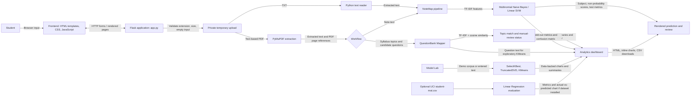
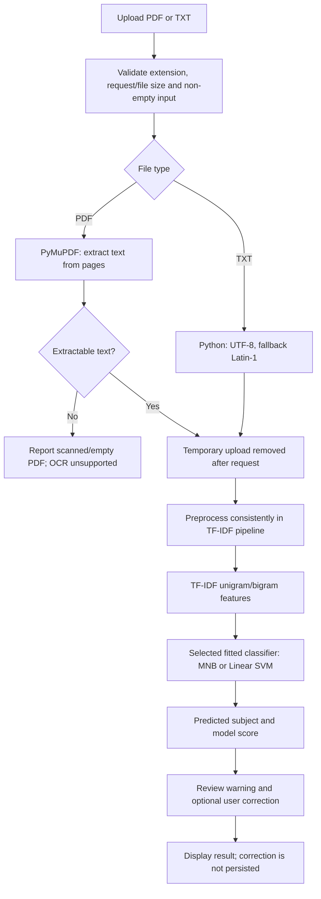
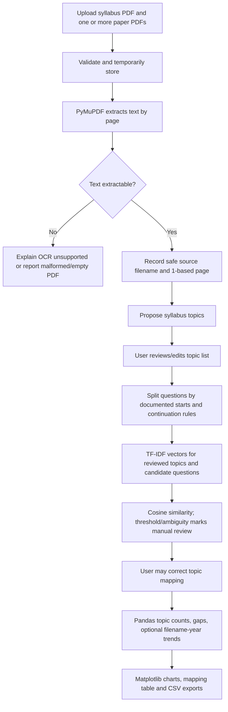

# StudySync — Project Submission Guide

This guide describes the checked-in implementation. Results below were
measured by running the project evaluation or test suite; they are not
predictions of performance on real student data.

## 1. System architecture

The UI uses server-rendered Jinja templates. Matplotlib charts are embedded as
data URIs in HTML responses; user uploads are not published under `static/`.
There is no database. QuestionBank review state is a bounded, process-local
memory cache, and the NoteMap pipeline is fitted in memory.

## 2. Data-flow diagrams

### NoteMap

Model evaluation is separate from an individual upload: the training command
uses the labelled demonstration CSV, a stratified fixed-seed 80/20 split, and
training-only stratified cross-validation. The test split is reserved for final
metrics.

### QuestionBank Mapper

Question-paper duplicate detection uses content hashes. Candidate splitting
does not treat every line as a question: numbered or recognizable prompt starts
begin candidates, following lines continue them, and a question-like paragraph
fallback is used where appropriate. Filename years are inferred, not
independently verified.

## 3. Machine learning concepts, implementation, and rationale

| Concept | Implementation | Purpose and selection rationale |
|---|---|---|
| Web application and request routing | `app.py`; `templates/` | Flask routes connect form uploads, validation, processing, and rendered results using a small Python web framework. |
| PDF/text extraction | `ml/text_extractor.py` | PyMuPDF extracts text and page content from text PDFs; Python reads TXT. Page-level extraction supports source references. OCR is deliberately not claimed. |
| Text preprocessing and TF-IDF | `ml/classifier.py`; `ml/similarity_mapper.py` | Lowercasing, Unicode accent handling, English stop-word removal, and unigram/bigram TF-IDF produce sparse numeric text vectors. TF-IDF is a transparent classical text baseline that downweights common terms. |
| Supervised classification | `ml/classifier.py` | Multinomial Naive Bayes is a fast probabilistic-model baseline for non-negative text features; Linear SVM offers a discriminative sparse-text comparison. |
| Train/test evaluation and cross-validation | `ml/classifier.py`; `ml/train_notemap.py` | Stratified 80/20 holdout measures final performance; five-fold stratified CV on training data selects a model. Pipeline-contained vectorizers limit vocabulary leakage. |
| Precision, recall, F1 and confusion matrix | `ml/classifier.py`; `ml/trend_analyzer.py` | Macro-averaged scores give each subject equal weight; the matrix exposes class-level correct/incorrect predictions. |
| Question segmentation and cosine similarity | `ml/similarity_mapper.py` | Explicit rules make candidate extraction reviewable; cosine similarity measures direction/overlap between sparse TF-IDF vectors and maps questions to a closest reviewed topic. It is a match score, not a probability. |
| Tabular analysis and visualization | `ml/trend_analyzer.py` | Pandas aggregates actual mapping counts/trends; Matplotlib charts current processed values. CSV exports support further inspection. |
| Feature selection | `ml/feature_selection.py` | SelectKBest with chi-squared scores demonstrates reducing sparse TF-IDF vocabulary and compares it with a full-feature Linear SVM using a held-out split. |
| Dimensionality reduction | `ml/dimensionality_reduction.py` | TruncatedSVD projects sparse TF-IDF to two dimensions without centering. This avoids PCA's centering step, which can make a large sparse matrix dense. A 2-D plot loses information and is only shown when dimensions/variation support it. |
| Unsupervised clustering | `ml/clustering.py` | KMeans groups TF-IDF documents; top terms, example documents, inertia, and cosine silhouette are descriptive aids. Clusters are not official syllabus labels. |
| Regression | `ml/regression.py` | Linear Regression predicts the numerical G3 target from selected numeric columns as a separate exercise. It uses a reproducible holdout and MAE/RMSE/R-squared, and runs on the real UCI CSV only. |
| Reproducibility and tests | `config.py`; `tests/` | Fixed seeds and automated route, extraction, pipeline, and workflow tests make behavior repeatable and check error/edge cases. |

## 4. Dataset documentation

### NoteMap demonstration corpus

| Property | Actual project data |
|---|---|
| File | `data/training/demo_notes.csv` |
| Source | Newly generated demonstration examples, not collected student work or an external dataset |
| Size | 60 labelled examples; 10 examples for each of 6 categories |
| Labels | Data Structures; Database Management Systems; Operating Systems; Computer Networks; Machine Learning; Artificial Intelligence |
| Fields | `subject` (label), `text` (example note) |
| Preprocessing | TF-IDF pipeline uses lowercase text, Unicode accent normalization, English stop-word removal, and one-/two-word n-grams; vectorizers fit within training pipelines |
| Split | Reproducible stratified 80/20 split with seed 42: 48 training, 12 test |
| CV | Stratified 5-fold cross-validation on the training partition only |

The generated examples are intentionally small and stylistically limited.
Results describe this split and do not demonstrate generalization to real
notes. The full dataset disclosure is in
[data/training/README.md](../data/training/README.md).

### Regression dataset (optional and currently absent)

The regression implementation expects the real UCI Student Performance
mathematics-course file `data/datasets/student-mat.csv`. Its selected inputs are
`studytime`, `failures`, `absences`, `G1`, and `G2`; its target is `G3`.
The source and download instructions are in
[data/datasets/README.md](../data/datasets/README.md). This checkout does not
contain the file, so **no real-dataset regression metrics are available or
reported**. A small synthetic frame exists inside a test solely to validate
the calculation and chart code; it is not app input, evidence, or a student
performance finding.

## 5. Measured model results

Results below were obtained by running
`.\.venv\Scripts\python.exe -m ml.train_notemap` and the Model Lab functions
from the current project environment. Metrics are shown to three decimals.

### NoteMap held-out classification (12 demonstration test examples)

| Model | Accuracy | Macro precision | Macro recall | Macro-F1 | Training CV macro-F1 (mean ± SD) |
|---|---:|---:|---:|---:|---:|
| Multinomial Naive Bayes | 0.667 | 0.639 | 0.667 | 0.628 | 0.744 ± 0.067 |
| Linear SVM | 0.667 | 0.639 | 0.667 | 0.628 | 0.742 ± 0.046 |

The selected model is Multinomial Naive Bayes because its observed training-only
CV macro-F1 mean was slightly higher in this run. Both held-out models had the
same rounded metrics. With only 12 held-out examples, a single prediction
changes accuracy by about 0.083; these scores are not robust real-world
estimates.

### Other Model Lab measurements on the NoteMap demonstration corpus

| Experiment | Measured result | Interpretation |
|---|---|---|
| Feature selection, Linear SVM baseline | Held-out accuracy 0.667; macro-F1 0.628 | Full TF-IDF feature comparison on the same reproducible 48/12 split. |
| Feature selection, SelectKBest chi-squared (30/1,043 features) | Held-out accuracy 0.750; macro-F1 0.750 | Observed on this one small generated-data split; it does not prove that selecting 30 terms is generally better. |
| TruncatedSVD | 60 documents, 1,291 TF-IDF features; component variance ratios 0.010 and 0.023; sum 0.033 | A lossy two-dimensional illustration retaining about 3.3% of measured variance in this run. |
| KMeans (4 clusters) | Inertia 55.027; cosine silhouette 0.009 | Very weak separation by this diagnostic; discovered groups should not be interpreted as official subjects/units. |
| Linear Regression on real UCI dataset | **Unavailable — dataset file absent** | No real-data MAE, RMSE, R-squared, or actual-versus-predicted chart is reported. |

Fixed seeds are used, but library versions and numerical implementations may
cause small cross-environment differences.

## 6. Automated test cases and actual outcomes

Executed on 2026-10-28 with the project virtual environment and
`.\.venv\Scripts\python.exe -m pytest <file> -q`.

| Test file / cases | Actual result |
|---|---:|
| `tests/test_app_routes.py` — pages, health, upload types, TXT/PDF, invalid inputs, cleanup | **13 passed** |
| `tests/test_classifier.py` — dataset labels, split/CV, scores, short/unknown text, leakage guard | **8 passed** |
| `tests/test_questionbank.py` — extraction rules, uploads, review/correction, sources/pages, trends, charts, CSV and empty state | **30 passed** |
| `tests/test_model_lab.py` — feature selection, SVD, clustering, regression validation and Model Lab routes | **15 passed** |
| `tests/test_text_extractor.py` — TXT/PDF extraction, unsupported types and page-count behavior | **7 passed** |
| **Complete suite** | **73 passed** |

The regression unit test's synthetic rows only test software behavior. They
are excluded from the regression result table above.

## 7. Limitations and future enhancements

### Not implemented / incomplete

- **Scanned-PDF OCR:** no OCR engine or OCR workflow is implemented. A PDF with
  no extractable text is rejected with a clear message.
- **Larger validated classification dataset:** NoteMap currently uses 60 newly
  generated examples. Replace/augment it with appropriately licensed, reviewed,
  representative data and a carefully designed evaluation before making
  real-world claims.
- **Real regression run:** the UCI `student-mat.csv` file is optional and is not
  present in this project checkout. Therefore real regression results are
  incomplete.
- **Persistent data and accounts:** no database, user accounts, or durable
  upload/result storage exists. QuestionBank review state is process-local,
  capped/expiring, and lost on restart; multi-worker deployments do not share
  it.
- **Question-paper date validation:** years are inferred from filenames and
  cannot confirm a paper's true year. Year trends are only shown when every
  unique uploaded paper has a parseable filename year and at least two
  different years are present.
- **Question segmentation and matching:** heuristic question splitting and
  lexical TF-IDF similarity may miss layouts, paraphrases, tables, formulas,
  or questions with little shared vocabulary. Users should review uncertain
  mappings.
- **Clusters are exploratory:** KMeans outputs do not establish semantic or
  syllabus correctness; the observed demo silhouette was 0.009.
- **Development server/configuration:** `app.py` runs Flask's development
  server. The fallback secret key is for local development only. Production
  deployment requires a production WSGI server and a strong configured secret.

### Possible next steps

1. Add OCR as an explicit, optional and testable workflow with language support
   and extraction-quality feedback.
2. Obtain a larger, permitted, human-reviewed note corpus; document collection,
   consent/licensing, label definitions, and a held-out evaluation protocol.
3. Install and validate the documented UCI file if regression results are
   needed for submission; report the resulting metrics only after a real run.
4. Persist workflow state safely for multi-user/multi-worker use, with
   authentication, retention limits, and access controls.
5. Improve question segmentation and topic matching using reviewed examples,
   while retaining manual correction and non-probabilistic score wording.
6. Add broader browser automation and accessibility checks to CI.

## 8. College presentation demonstration script (about 5–7 minutes)

1. **Introduce the problem (30 seconds).** Explain that students often need to
   organize notes and compare prior questions with a syllabus. State that this
   prototype demonstrates workflows; it does not predict exam questions.
2. **Show the architecture (45 seconds).** Walk through the diagram: browser →
   Flask → extraction → ML/analysis → rendered results. Note that uploads are
   temporary and there is no database.
3. **Run NoteMap (60 seconds).** Open `/notemap`, choose a short, text-based
   sample `.txt` note, submit it, and show the predicted subject, model score
   label, held-out demonstration caveat, and correction form. Clarify that the
   displayed score is not a probability.
4. **Run QuestionBank (90 seconds).** Upload a text-based syllabus PDF and at
   least two distinct question-paper PDFs. Review/edit topics, inspect mappings,
   source filenames and page numbers, then change one mapping and recalculate.
   Open Analytics to show updated frequencies and year trends where filenames
   include distinct years; download the CSV exports.
5. **Show Model Lab (60 seconds).** Point out SelectKBest/chi-squared,
   TruncatedSVD, KMeans, and the regression section. Explain that regression
   remains unavailable until the real UCI file is supplied.
6. **Explain measured results (60 seconds).** Present the classification table
   and emphasize the 60 generated-example limitation and 12-item test split.
   Mention that the KMeans silhouette was 0.009, so the observed grouping
   separation was weak.
7. **Close with limitations (30 seconds).** State that scanned-PDF OCR,
   durable storage, large validated note data, and the real-data regression run
   remain incomplete. Invite questions.

Use only files you are authorized to present. Avoid uploading private student
notes or personal data in a public classroom demonstration.

## 9. Likely viva questions and short answers

1. **What is Flask?**  
   Flask is a Python web framework. Here it maps HTTP routes to upload handling,
   ML/analysis functions, and Jinja-rendered pages.

2. **What is TF-IDF?**  
   Term Frequency–Inverse Document Frequency weights terms by their frequency
   in a document and rarity across the fitted corpus. It provides numeric,
   sparse text features for the classifiers and similarity baseline.

3. **How does Multinomial Naive Bayes work here?**  
   It applies Bayes' rule with a conditional-independence assumption over
   non-negative text features. It is a fast baseline; the assumption is a
   simplification and its displayed log scores are not calibrated probabilities.

4. **What is Linear SVM?**  
   A linear Support Vector Machine learns a separating hyperplane with a
   maximum-margin objective. It is commonly effective for high-dimensional
   sparse text, but its decision margin is not a probability.

5. **What does cosine similarity measure?**  
   It compares the angle between two vectors. For TF-IDF vectors, a higher
   cosine value means more shared weighted terms; it is not the probability
   that a topic will appear in an exam.

6. **Why use cross-validation?**  
   It evaluates a model across multiple folds of the training data, reducing
   dependence on one training split for model selection. The final test set
   remains separate for final metrics.

7. **Define precision.**  
   Precision is `TP / (TP + FP)`: among items predicted as a class, the
   fraction that truly belong to that class.

8. **Define recall.**  
   Recall is `TP / (TP + FN)`: among actual items of a class, the fraction
   correctly found by the model.

9. **What is F1-score?**  
   F1 is the harmonic mean of precision and recall:
   `2 * precision * recall / (precision + recall)`. Macro-F1 averages class
   F1 scores equally across classes.

10. **What is a confusion matrix?**  
    It counts actual versus predicted classes. Correct classifications appear
    on the diagonal; off-diagonal cells show which classes were confused.

11. **What is clustering?**  
    Clustering is unsupervised grouping without known target labels. StudySync
    uses KMeans on TF-IDF vectors; clusters are exploratory, not official units.

12. **What is Linear Regression, and how is it evaluated?**  
    It models a numerical target as a linear combination of features. The
    experiment uses a holdout and MAE, RMSE, and R-squared, but real-dataset
    results are unavailable until the UCI CSV is present.

13. **How does TruncatedSVD differ from PCA?**  
    TruncatedSVD can operate on sparse matrices without centering them. PCA
    centers data, which can destroy sparsity and increase memory use for
    large text matrices. A two-component projection is lossy.

14. **How are PDFs extracted? Does the system support scanned PDFs?**  
    PyMuPDF reads extractable text page by page and keeps page references for
    QuestionBank. Scanned image PDFs have no extractable text in this workflow;
    OCR is not implemented, so the app reports that limitation instead.

15. **Why do you need both a validation split and a test split?**  
    The training-only cross-validation supports model selection. A separate
    held-out test partition provides the final estimate after selection,
    reducing the risk of reporting a metric that was optimized during tuning.

16. **What does the low silhouette score mean?**  
    The measured score of 0.009 indicates weak separation under the cosine
    silhouette diagnostic for this demonstration run. It does not prove that
    clusters are meaningful or useful.
